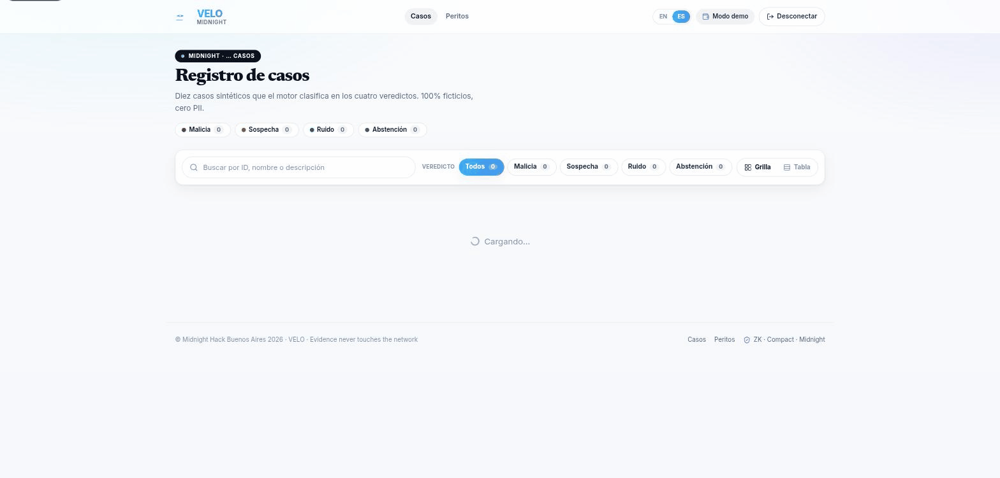

# VELO

> **El veredicto se ve. La víctima no.**

[English](./README.md) · [Español](./README.es.md) · [README técnico](./TECHNICAL_README.md)

VELO permite que un perito publique un veredicto verificable sin publicar la
evidencia que lo sustenta. El caso queda en la máquina del perito; Midnight
recibe un commitment público y, cuando se usa el write path, una prueba de
conocimiento cero.

## Miralo primero

- [Abrí el VELO Hub](https://velo-hub-zeta.vercel.app/)
- [Navegá la app en vivo](https://velo-1048644120951.us-central1.run.app/)
- [Verificá el contrato desplegado](https://preview.midnightexplorer.com/contracts/0x46cac58c4eb0e034b4211d754bfe67f7e8e1aa08d448ebd089437ed573023d9d)
- [Mirá la demo](https://youtu.be/AHBEUcrzf48)



## El problema

El trabajo forense suele obligar al perito a elegir entre exponer evidencia
delicada para que otros revisen el veredicto o no publicar nada y pedir que le
crean. VELO vuelve auditable el veredicto mientras mantiene privado el caso.

## Qué pasa

1. El perito conserva discos, logs y capturas en su máquina.
2. VELO analiza el caso con un motor determinista; una IA puede narrar el
   resultado, pero no puede elegirlo.
3. El motor aplica reglas fijas de evidencia, custodia y admisibilidad.
4. El resultado se sella localmente con hashing canónico y metadatos de custodia.
5. Una prueba de conocimiento cero puede demostrar que la atestación pública
   cumple las reglas sin revelar el caso.
6. Un juez, la contraparte o el público puede verificar el resultado público.

El sistema también se niega. Si falta corroboración, baja el resultado; si se
rompe la cadena de custodia, produce `ABSTAIN`. Corré `npm run simulate` para
ver los dos comportamientos.

## Por qué importa

| Flujo típico | VELO |
|---|---|
| Publicar evidencia sensible para revisarla | Mantenerla local y publicar una prueba sobre el proceso |
| Pedir confianza en un veredicto opaco | Exponer un commitment, un veredicto y un resultado verificable |
| Dejar que la narrativa o la presión decidan | Sellar el resultado determinista antes de narrarlo |

## Probalo localmente

Requisito: Node.js 20 o posterior.

```bash
git clone https://github.com/annatchijova/velo.git
cd velo
npm install
npm run build
cd frontend
npm run dev
```

Para el flujo completo, los casos, las demos y los comandos de verificación,
consultá [`docs/QUICKSTART.md`](./docs/QUICKSTART.md). Para arquitectura,
invariantes, protocolos, modelo de amenazas y limitaciones, consultá el
[README técnico](./TECHNICAL_README.md).

## Evidencia del proyecto

- Los tests root cubren el motor determinista y los casos adversariales.
- Los tests del frontend cubren el comportamiento visible del navegador.
- `npm run simulate` demuestra los caminos de rechazo.
- `node scripts/verify-chain-read.mjs` lee el ledger público de preview sin
  credenciales de wallet.

Estas comprobaciones respaldan los comportamientos que cubren; no son una
prueba general de corrección forense.

## Explorar el proyecto

- [Inicio rápido](./docs/QUICKSTART.md)
- [Estado técnico](./docs/TECHNICAL_STATUS.md)
- [Decisiones de arquitectura](./docs/ADRS_001_006.md)
- [Informes red team](./docs/RED_TEAM_ROUND_1.md)
- [Casos](./cases/README.md)
- [Frontend](./frontend/README.md)
- [Contribuir](./CONTRIBUTING.md)

## Estado

El motor determinista, el sellado local, el verificador offline, el servidor MCP,
el contrato Compact, el despliegue de preview, la atestación on-chain por CLI y
la lectura del ledger están implementados según el alcance documentado en
[`docs/TECHNICAL_STATUS.md`](./docs/TECHNICAL_STATUS.md). La firma desde el
navegador no se presenta como implementada.

## Licencia

Apache-2.0. Ver [`package.json`](./package.json).
