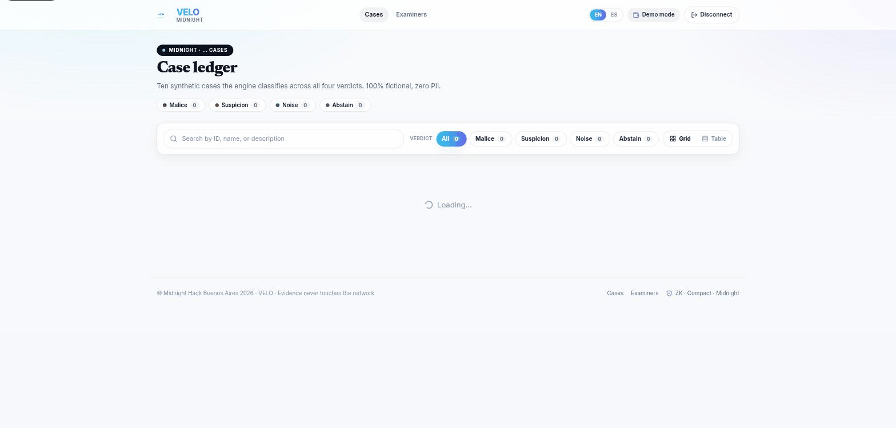

# VELO

> **The verdict is visible. The victim is not.**

[English](./README.md) · [Spanish README](./README.es.md) · [Technical README](./TECHNICAL_README.md)

VELO lets a forensic expert publish a verifiable verdict without publishing the
evidence behind it. The case stays on the expert's machine; Midnight receives a
public commitment and, when the write path is used, a zero-knowledge proof.

## See it first

- [Open the VELO Hub](https://velo-hub-zeta.vercel.app/)
- [Browse the live app](https://velo-1048644120951.us-central1.run.app/)
- [Verify the deployed contract](https://preview.midnightexplorer.com/contracts/0x46cac58c4eb0e034b4211d754bfe67f7e8e1aa08d448ebd089437ed573023d9d)
- [Watch the demo](https://youtu.be/AHBEUcrzf48)



## The problem

Forensic work usually forces an expert to choose between exposing sensitive
evidence so others can check the verdict and publishing nothing so others must
trust the expert. VELO makes the verdict auditable while keeping the underlying
case private.

## What happens

1. The expert keeps disk images, logs, and captures locally.
2. VELO analyzes the case through its deterministic engine; an LLM may narrate
   the result but cannot choose it.
3. The engine applies fixed evidence, custody, and admissibility rules.
4. The result is sealed locally with canonical hashing and custody metadata.
5. A zero-knowledge proof can show that the public attestation follows the
   required rules without revealing the case.
6. Judges, opposing experts, or the public can verify the public result.

The system also refuses. A missing corroboration gate lowers the result, and a
broken custody chain produces `ABSTAIN`. Run `npm run simulate` to see both
behaviors.

## Why it matters

| Typical workflow | VELO |
|---|---|
| Publish sensitive evidence for review | Keep evidence local and publish a proof about the process |
| Ask others to trust an opaque verdict | Expose a commitment, verdict, and verifiable protocol result |
| Let narrative or operator pressure decide | Seal the deterministic result before narration |

## Try it locally

Requirements: Node.js 20 or newer.

```bash
git clone https://github.com/annatchijova/velo.git
cd velo
npm install
npm run build
cd frontend
npm run dev
```

For the complete workflow, cases, demos, and verification commands, see
[`docs/QUICKSTART.md`](./docs/QUICKSTART.md). For architecture, invariants,
protocols, threat model, and limitations, see the
[Technical README](./TECHNICAL_README.md).

## Project evidence

- Root tests cover the deterministic engine and adversarial cases.
- Frontend tests cover the browser-facing behavior.
- `npm run simulate` demonstrates refusal paths.
- `node scripts/verify-chain-read.mjs` reads the public preview ledger without
  wallet credentials.

These checks support the behaviors they cover; they are not a general proof of
forensic correctness.

## Explore the project

- [Quickstart](./docs/QUICKSTART.md)
- [Technical status](./docs/TECHNICAL_STATUS.md)
- [Architecture decisions](./docs/ADRS_001_006.md)
- [Red-team reports](./docs/RED_TEAM_ROUND_1.md)
- [Cases](./cases/README.md)
- [Frontend](./frontend/README.md)
- [Contributing](./CONTRIBUTING.md)

## Status

The deterministic engine, local sealing, offline verifier, MCP server, Compact
contract, preview deployment, on-chain CLI attestation, and ledger read path are
implemented to the scope documented in [`docs/TECHNICAL_STATUS.md`](./docs/TECHNICAL_STATUS.md).
Browser signing is not presented as implemented.

## License

Apache-2.0. See [`package.json`](./package.json).
