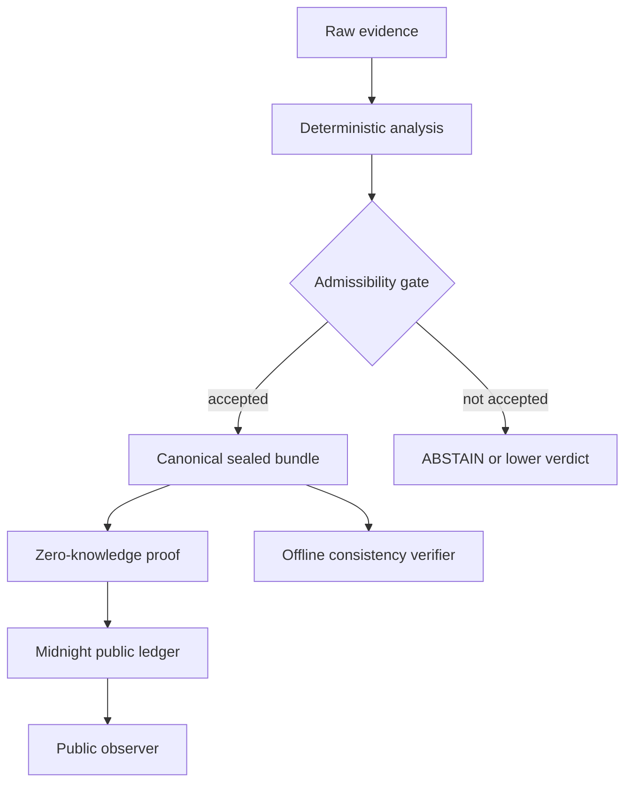

# VELO Technical README

This document is the engineering reference for VELO. The human-facing entry
points are [`README.md`](../README.md) and [`README.es.md`](../README.es.md).

## Scope and evidence

VELO is a local forensic-analysis engine, a sealed-bundle format, an MCP
interface, a browser frontend, and a Compact contract for public attestation.
The implementation is TypeScript plus Compact and targets Node.js 20 or newer.

The claims in this document are bounded by the evidence available in the
repository:

- `npm test` builds the root package and runs the engine tests.
- `cd frontend && npx vitest run` runs the frontend tests.
- `npm run simulate` exercises the refusal paths and custody-sensitive result.
- `node scripts/verify-chain-read.mjs` reads the deployed preview ledger without
  a wallet.
- `deploy/attest-forced-malice.ts` is the direct contract-level corroboration
  test for the `MALICE` gate.

These checks demonstrate the behavior they cover. They do not establish that
the system is correct for every possible forensic workflow.

## System boundary

Raw evidence remains on the expert's machine. The public boundary carries only
the sealed analysis commitment, the declared verdict, metadata required by the
protocol, and a zero-knowledge proof when the write path is used.



The LLM narrator is outside the decision path. It receives a read-only summary
after the deterministic result is sealed and can change prose, but not the
verdict, seal, commitment, or custody chain.

## Repository map

```text
src/analysis/      Pre-analysis and input preparation
src/engine/        Deterministic scoring, detectors, evidence, and verdicts
src/inference/     Inform-only abductive reasoning
src/seal/          Canonical encoding, sealing, custody, Merkle data, verifier
src/witness/       Witness construction for the Compact circuits
src/perito/        Credential, registry, visibility, validity, and opinions
src/mcp/           MCP server and persistence adapter
src/narrative/     Read-only narrative generation and backends
src/chain/         Public-ledger reads and post-attestation integration
deploy/            CLI write path and contract deployment helpers
frontend/          Next.js application and HTTP API
tests/             Root behavioral and adversarial evidence
docs/              Technical, operational, and decision documentation
```

## Deterministic engine

The engine is implemented in `src/engine/`. Counts are integers and ratios use
exact rational arithmetic through `src/engine/fraction.ts`; floats are not part
of the sealed decision path. Detector output is normalized before scoring, and
the final result is sealed before narrative generation.

The verdict scale is intentionally conservative:

| Verdict | Meaning |
|---|---|
| `NOISE` | No supported signal crosses the configured floor. |
| `SUSPICION` | A signal exists, but the stronger gate is not met. |
| `MALICE` | The score and admissibility requirements are met. |
| `ABSTAIN` | A required validity or custody condition cannot be established. |

`MALICE` requires at least two corroborating sources under distinct provenance
roots. The application computes the provenance count off-chain; the Compact
circuit enforces the minimum count supplied to it. This distinction is a
security boundary, not an implementation detail.

The adversarial and determinism tests cover score thresholds, custody, witness
construction, chain integrity, visibility, and repeatability. Use the test names
as the authoritative index rather than treating a test count as a proof of
complete correctness.

## Sealing and verification

`src/seal/canonical.ts` is the canonical serialization path. Values are
type-tagged, recursively ordered, and versioned so that semantically different
values cannot silently share an encoding. `src/seal/bundle.ts` produces the
sealed bundle and SHA-256 digest. Custody metadata and the Merkle structures are
handled by `src/seal/custody.ts` and `src/seal/merkle.ts`.

The standalone verifier in `src/seal/verify.ts` is deliberately independent of
the producing pipeline. It reports internal consistency, not truth of the
underlying forensic conclusion. A consistent bundle proves that its bytes and
relationships agree; it does not prove that the original evidence was genuine
or that the expert's interpretation was correct.

## MCP and frontend contracts

The MCP server exposes the local workflow, including case sealing and public
chain status. The browser frontend calls the same engine through server-side
routes. The current HTTP surface is:

| Method | Route | Behavior |
|---|---|---|
| `POST` | `/api/seal` | Analyze and seal a case. |
| `GET` | `/api/cases` | List public case summaries and unreadable records. |
| `GET` | `/api/cases/:id` | Read one public case summary. |
| `POST` | `/api/verify` | Check internal consistency, optionally against a tampered copy. |
| `GET` | `/api/chain` | Read the Midnight ledger without wallet credentials. |
| `GET` | `/api/peritos` | Read the synthetic expert-witness corpus. |
| `GET` | `/api/attest` | Returns `501`; browser signing is not implemented. |

Corpus routes are static at build time. Chain reads use committed contract
bindings and do not require a wallet, proving key, or proof server. Attestation
writes stay on the expert's machine through `deploy/attest-case.ts`.

## Compact contract and write path

The contract is the public enforcement boundary for the values it receives. It
binds the declared verdict and commitment and rejects a `MALICE` attestation
whose corroboration count is below the required minimum. The direct negative
test in `deploy/attest-forced-malice.ts` exercises the circuit without relying
on the application gate.

The operational sequence is:

1. Seal the case locally.
2. Build witnesses from the sealed result.
3. Generate the proof and submit the commitment through the CLI.
4. Reveal the public attestation to the deployed preview contract.
5. Read the result back through the ledger reader or the explorer.

The deployed preview address and current operational status are maintained in
[`docs/TECHNICAL_STATUS.md`](./TECHNICAL_STATUS.md) and
[`docs/CHAIN.md`](./CHAIN.md), not duplicated here.

## Threat model and trust boundaries

VELO assumes the expert's execution environment can access the raw evidence and
the proving material. It does not claim to protect evidence from a compromised
expert workstation, a malicious prover who controls every witness before proof
generation, or a false statement already accepted as input.

The main boundaries are:

- **Evidence to engine:** local input validation and deterministic analysis.
- **Engine to seal:** canonical serialization and custody-linked digest.
- **Seal to narrator:** read-only summary; no feedback channel to the result.
- **Seal to contract:** witness values and circuit assertions.
- **Ledger to observer:** public metadata and proof verification, not raw case data.

The chain proves integrity and protocol relations under these boundaries. It does
not prove the truth of a forensic proposition merely because the proposition is
signed, hashed, or attested.

## Known limitations and non-goals

The circuit cannot independently observe whether supplied witnesses came from a
real run over real evidence. Provenance independence is computed off-chain and
declared by the analyst; the circuit checks the count it receives.

Ledger metadata and wallet identity can still create linkability. Rule versions,
credential revocation, selective disclosure, and browser-based signing remain
bounded or incomplete areas. The browser attestation endpoint is intentionally
not presented as implemented.

VELO does not identify victims, replace expert judgment, make inadmissible
evidence admissible by itself, or prevent a trusted operator from making a false
statement before sealing. These are non-goals, not hidden guarantees.

See the complete adversarial record in `docs/RED_TEAM_ROUND_1.md` through
`docs/RED_TEAM_ROUND_6.md`, and the decision history in
`docs/ADRS_001_006.md`.

## Reproducibility and operations

```bash
npm install
npm test
npm run simulate
cd frontend && npx vitest run
```

For a local UI, run `npm run build` at the repository root and then
`cd frontend && npm run dev`. Development binds to loopback; the container's
production entrypoint may bind to `0.0.0.0` because the container is the
deployment boundary.

Use `docs/QUICKSTART.md` for the copy-paste workflow, `docs/CHAIN.md` for the
preview ledger, and `CONTRIBUTING.md` plus `AGENTS.md` for repository changes.

## Design decisions

The current design deliberately keeps deterministic computation, sealing,
narrative generation, and public attestation as separate layers. Alternatives
such as uploading evidence to a hosted service, allowing the narrator to choose
the verdict, or treating an internal hash check as authenticity were rejected
because they collapse trust boundaries or overstate what the evidence proves.
The ADR files and red-team reports record the detailed rationale and the
conditions that would reopen these decisions.
